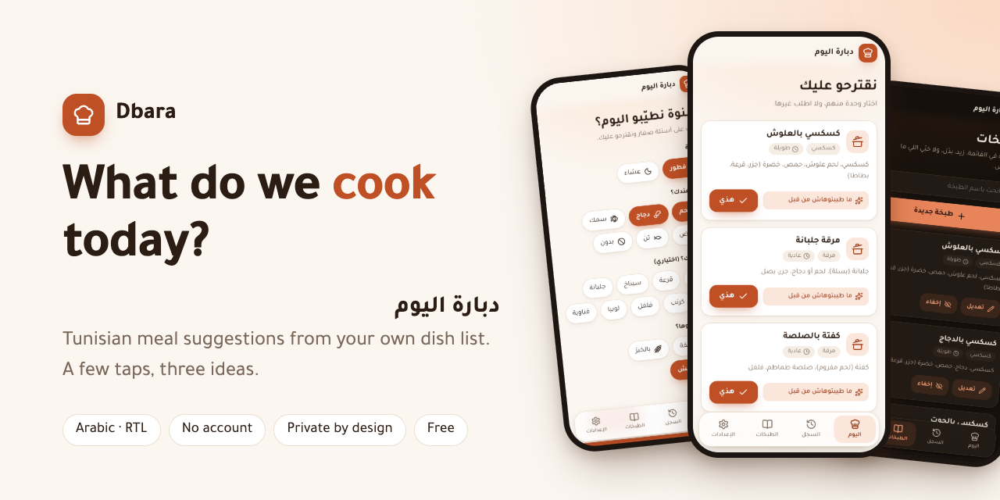
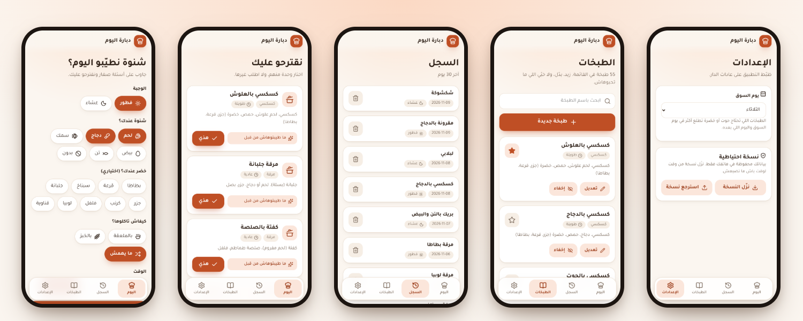

# دبارة اليوم

**تطبيق صغير يجاوب على سؤال كل بيت تونسي: شنوة نطيّبو اليوم؟**

**[افتح التطبيق](https://khalilrhouma.github.io/dbara/)** · [English](README.md)

---

## فكرة التطبيق

كل يوم نفس السؤال في الدار: «شنوة نطيّبو اليوم؟». التطبيقات الموجودة تقترح وصفات عشوائية من كل العالم، ولا تعرف
ما هو متوفر عندك، ولا ما طبختموه البارحة، ولا هل تأكلون بالملعقة أو بالخبز.

**دبارة اليوم** يجمع كل هذا: طبخات تونسية من قائمتكم أنتم، حسب ما عندك في البيت، وبدون تكرار.
تفتح التطبيق، تجاوب على أسئلة صغيرة بالنقر، وفي أقل من نصف دقيقة يعطيك ثلاث اقتراحات.

## كيف تستعمله

1. افتح الرابط على هاتفك.
2. اختر **الوجبة** (فطور أو عشاء)، و**ما هو متوفر** (لحم، دجاج، سمك، بيض، تن، أو بدون)، و**الخضر** التي عندك إن أردت (اختياري)، و**طريقة الأكل** (بالملعقة أو بالخبز)، و**الوقت**.
3. اضغط **«اقترح عليّ»**: تظهر ثلاث طبخات، مع سبب قصير لكل واحدة.
4. اضغط **«هذي»** على التي اخترتها فتُسجَّل في السجل. أو اضغط **«غيرها»** لترى ثلاث أخرى.
5. إذا أكلتم باقي أكل الغداء، اضغط **«عندنا باقي»** فيُسجَّل في السجل بدون اقتراح.

نصيحة: من الإعدادات اختر **يوم السوق**، فتظهر أكثر الطبخات التي تحتاج حوتا أو خضرة طازجة في يوم السوق واليوم الذي بعده.

## ماذا يعطيك

- **أسئلة سريعة بدون كتابة.** والتطبيق يتذكر اختياراتك الأخيرة.
- **اقتراحات ذكية بقواعد بسيطة:** لا يكرر الطبخة في آخر ثلاثة أيام، ولا يقترح نفس نوع الأكلة يومين متتاليين (مقرونة بعد مقرونة).
- **يعرف عادات عائلتكم:** في الغداء الطبخات التي تطبخونها برشا تأتي أولا، والشربة والمقرونة الجارية بعدها (وأكثر في الشتاء). العشاء يبقى خفيفا، ونهاية الأسبوع تفضّل الطبخات الأطول والأثقل. ويمكنك تحديد نهار مفضل لطبخة (مثلا كسكسي نهار الجمعة).
- **قائمتكم أنتم:** 55 طبخة تونسية للبداية، لكل واحدة منها سطر قصير بمكوناتها الأساسية. أضف طبخة، عدّلها، ضعها في المفضلة، أو أخفِها.
- **سجل** لما طبختموه في آخر 30 يوما.
- **خصوصية كاملة:** بدون حساب وبدون خادم. بياناتك تبقى في هاتفك فقط.
- **نسخة احتياطية:** نزّل ملفا بكل بياناتك واسترجعه وقتما تريد.
- **تصميم عصري** باللغة العربية من اليمين إلى اليسار، مع وضع ليلي تلقائي.

## صور من التطبيق

## معلومات مهمة

- البيانات محفوظة في **متصفح هاتفك**. إذا استعملت هاتفين، فكل هاتف له سجله الخاص (المزامنة بين هاتفين مخطط لها لاحقا).
- من وقت لوقت، نزّل **نسخة احتياطية** من الإعدادات حتى لا تضيع بياناتك إذا مسحت بيانات المتصفح.
- قائمة الطبخات الأولية تقديرية. راجعوها مع العائلة: احذفوا ما لا تطبخونه وأضيفوا طبخات الدار.

## للمطورين

الأوامر، والبنية التقنية، وطريقة التشغيل والنشر موجودة في [الملف الإنجليزي](README.md).
المواصفات الكاملة (بالعربية) في [`docs/PLAN.md`](docs/PLAN.md).

## الرخصة

[MIT](LICENSE) © Khalil Rhouma

