<div align="center">

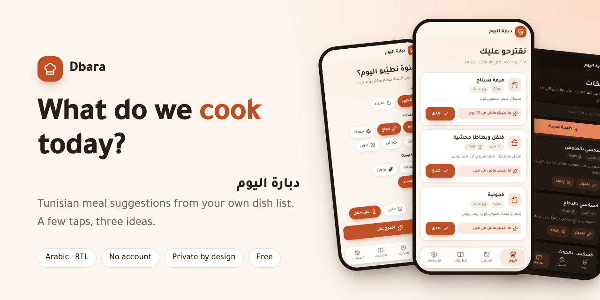

# Dbara · دبارة اليوم

**A small web app that answers one question for a Tunisian family: what do we cook today?**

[](https://github.com/khalilRhouma/dbara/actions/workflows/deploy.yml)
[](LICENSE)


**[Open the app](https://khalilrhouma.github.io/dbara/)** · [العربية](README.ar.md) · [Plan (Arabic)](docs/PLAN.md)

</div>

---

## Why Dbara

Every home has the same daily question. Existing recipe apps are built for the whole world:
they suggest random recipes, or ask you to type your ingredients, and they do not know a
Tunisian *kammounia* from a *marqa*. None of the apps I found combined all four things that
matter at home:

1. **Tunisian dishes**, in your own list.
2. **What you have today** (meat, chicken, fish, eggs, tuna, or nothing).
3. **What you cooked recently**, so you do not eat the same thing twice in a row.
4. **How you eat it**: with a spoon or with bread.

Dbara does exactly that, in about two taps.

## Features

- **Four quick questions, no typing.** Meal, protein you have, how you eat, time. The meal is
  chosen from the clock, and your last answers are remembered.
- **Three suggestions with a reason**, such as "not cooked for 11 days" or "fresh from the market".
  "غيرها" shows the next three.
- **Remembers what you cooked.** It will not suggest the same dish for 3 days, and it avoids
  the same family of dishes (pasta after pasta).
- **Knows the season and your habits.** Winter dishes (soups, jariya pasta) are rarely suggested in summer, and the other way round. Set a favorite day for a dish, such as couscous on Friday.
- **Knows market day.** Dishes that need fresh fish or vegetables are preferred right after you shop.
- **Your own dish list.** 55 Tunisian dishes to start, each with a short list of its main components. Add, edit, favorite or hide any of them.
- **Private by design.** No account and no server. Everything stays in your phone's browser.
- **Backup and restore** as a simple JSON file. A bad file is rejected without changing anything.
- **Modern, mobile-first design** in Arabic (right-to-left), with automatic dark mode.

## Screenshots

<table>
  <tr>
    <td align="center">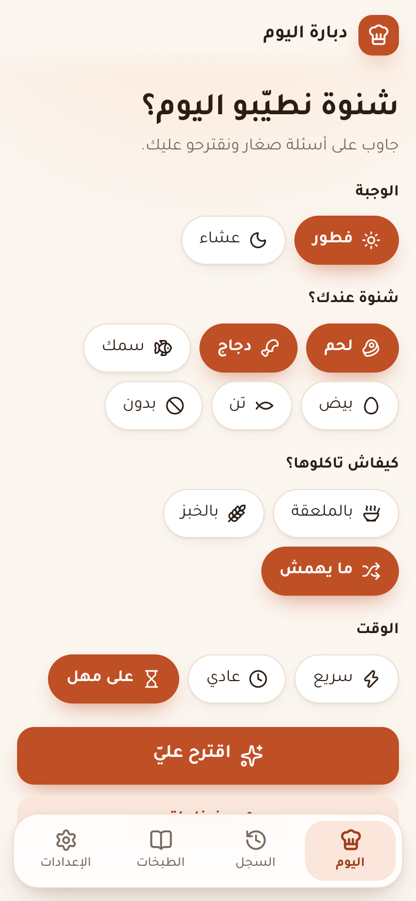<br><sub>Questions</sub></td>
    <td align="center">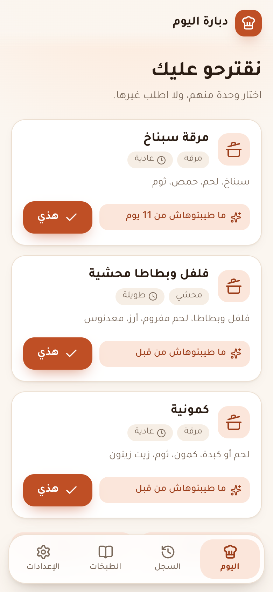<br><sub>Suggestions</sub></td>
    <td align="center">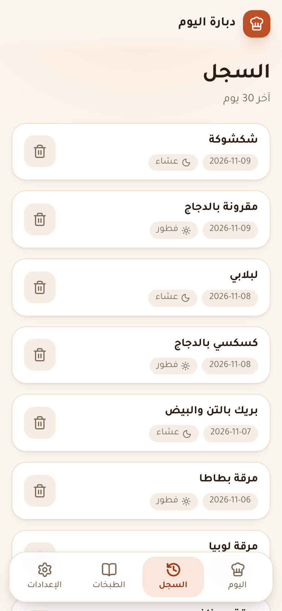<br><sub>History</sub></td>
    <td align="center">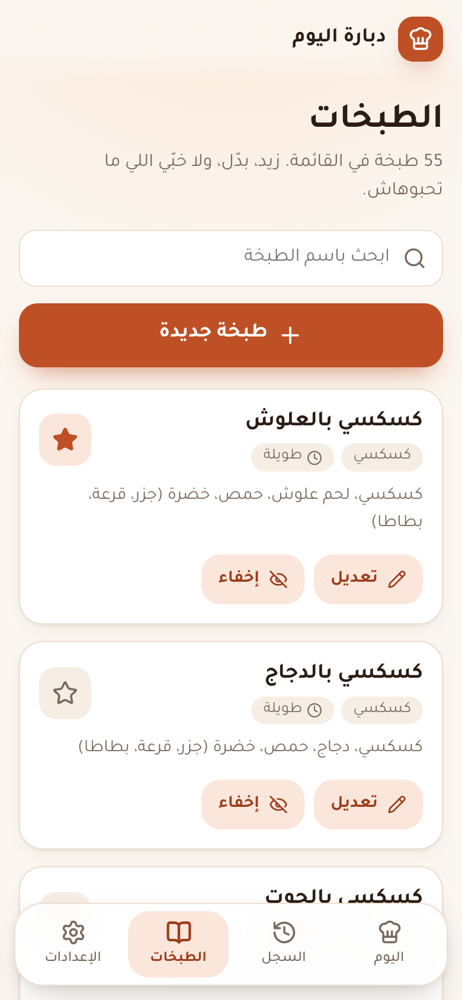<br><sub>Dish list</sub></td>
    <td align="center">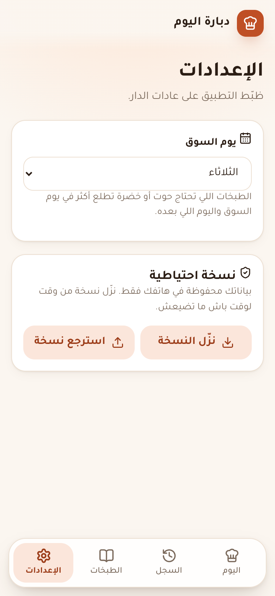<br><sub>Settings</sub></td>
  </tr>
  <tr>
    <td align="center">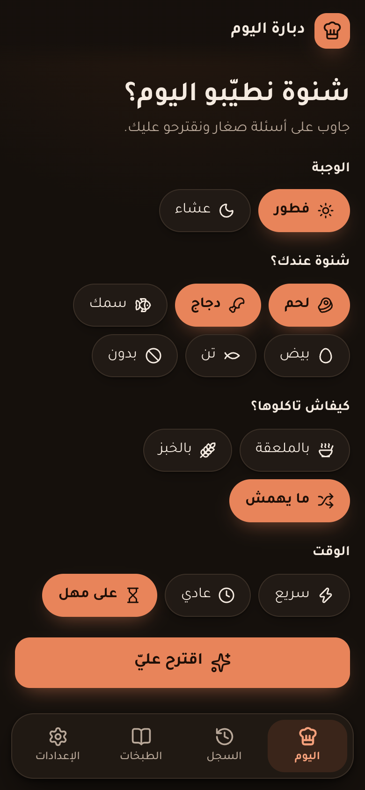</td>
    <td align="center">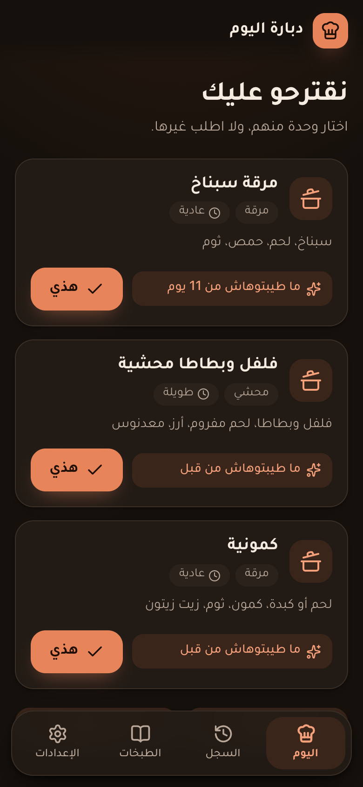</td>
    <td align="center">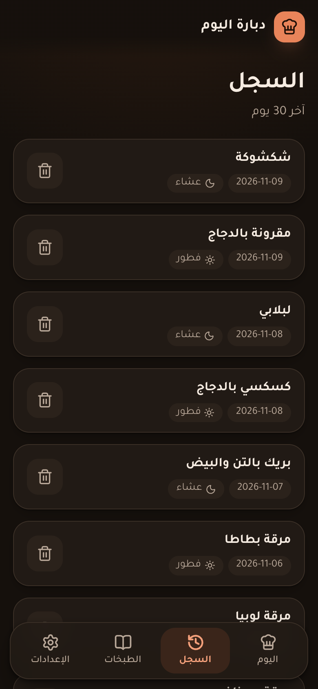</td>
    <td align="center">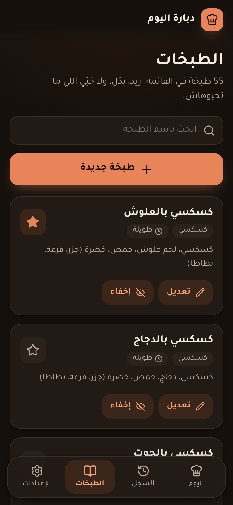</td>
    <td align="center">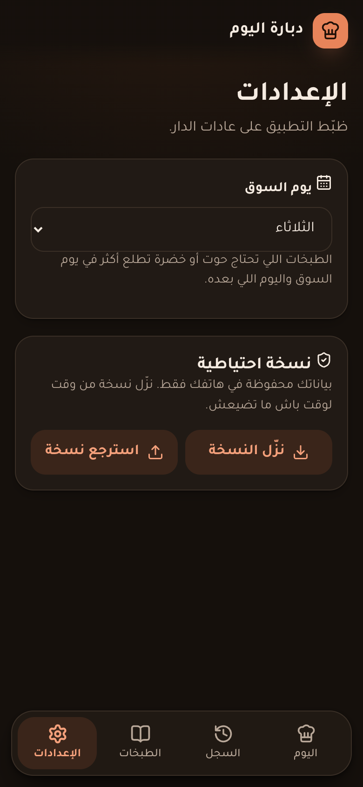</td>
  </tr>
</table>

## How the suggestions work

The rules are one pure function with all the numbers in one place:
[`src/domain/suggest.ts`](src/domain/suggest.ts).

1. **Filter.** Remove dishes that are hidden, for the other meal, need a protein you do not have,
   do not match how you eat, take too long, or were cooked in the last 3 days. If fewer than three
   dishes are left, it drops the eat-with limit first, then the time limit, and tells you.
2. **Score.** Each dish starts at 10 points.

   | Rule | Points |
   |---|---|
   | Cooked 4 to 7 days ago | −6 |
   | Cooked 8 to 14 days ago | −2 |
   | Same family as yesterday's dish | −5 |
   | Same main protein as today's or yesterday's dish | −2 |
   | Favorite | +3 |
   | Today is one of the dish's favorite days | +4 |
   | Matches the season | +3 |
   | Wrong season (rare, not forbidden) | −9 |
   | Fresh dish, on or just after market day | +3 |
   | A little randomness | 0 to 2 |

3. **Show.** The top three, each with a short reason.

The full specification (in Arabic) is in [`docs/PLAN.md`](docs/PLAN.md).

## Getting started

You need Node.js 22 or newer.

```bash
npm install
npm run dev        # http://localhost:5173
```

| Command | What it does |
|---|---|
| `npm run dev` | Dev server with hot reload |
| `npm test` | Unit tests (Vitest, 125 tests) |
| `npm run lint` | Lint (oxlint) |
| `npm run build` | Type check and production build into `dist/` |
| `npm run preview` | Serve the production build locally |
| `npm run dishes` | Rebuild `src/data/dishes.json` from the table in `docs/dishes.md` |
| `npm run screenshots` | Rebuild the images in `docs/images/` (needs Chrome) |

> `.npmrc` sets `legacy-peer-deps=true` because npm 10 crashes on Vitest 4 peer dependencies.

### Test on your phone

Phone and computer must be on the same Wi-Fi:

```bash
npm run dev -- --host
```

Open the `Network` address it prints (for example `http://192.168.1.20:5173`) in Chrome on the phone.

## Tech stack

| | |
|---|---|
| UI | React 19, TypeScript (strict), Vite |
| Style | Plain CSS with design tokens, Tajawal font, [Lucide](https://lucide.dev) icons |
| Data | Browser `localStorage`, validated with [Valibot](https://valibot.dev) |
| Tests | Vitest: rules, storage, backup import, and the daily flow |
| Hosting | GitHub Pages, deployed by GitHub Actions |

## Project structure

```text
src/
  domain/      Pure logic, no browser code: types, dates, suggestion rules
  data/        Built-in dishes (dishes.json) and their validation test
  storage/     localStorage store, validation of saved and imported data, backup
  screens/     One file per screen: Ask, Suggestions, History, Dishes, Settings
  components/  Shared UI pieces and the icon map
  i18n/        All interface texts (Arabic) in one file
scripts/       build-dishes.mjs (table to JSON) and screenshots.mjs (README images)
docs/
  PLAN.md      Specification and implementation plan (Arabic)
  dishes.md    The initial dish table, the source for src/data/dishes.json
  images/      Screenshots
```

Dishes live in `docs/dishes.md` as a table that the family can read and edit. After editing it, run
`npm run dishes` to update `src/data/dishes.json`. A test fails if the two are out of sync.

## Data and privacy

History, settings and your dish edits are saved in the browser's `localStorage`, under keys that
start with `dbara.v1.`. Nothing is sent anywhere, and there is no tracking. Data is per browser and
per device. Use **Settings → "نزّل النسخة"** to download a backup file, and **"استرجع نسخة"** to restore it.

## Deploy

Every push to `main` runs [`deploy.yml`](.github/workflows/deploy.yml): lint, tests, build, then
publish `dist/` to GitHub Pages. Pull requests run the same checks without publishing
([`ci.yml`](.github/workflows/ci.yml)). Asset paths are relative, so the site works under
`https://<user>.github.io/dbara/` without extra setup.

## Roadmap

- [x] Version 1: questions, suggestions, history, dish list, backup, free hosting
- [ ] Installable app (PWA) that works offline
- [ ] Two phones sharing the same history and dish list
- [ ] Shopping list, weekly plan, recipes

## Contributing

Ideas and bug reports are welcome in the [issues](https://github.com/khalilRhouma/dbara/issues).
The dish list is the heart of the app: if a Tunisian dish is missing or wrongly classified,
please open an issue or a pull request that edits `docs/dishes.md` and `src/data/dishes.json`.

## License

[MIT](LICENSE) © Khalil Rhouma
